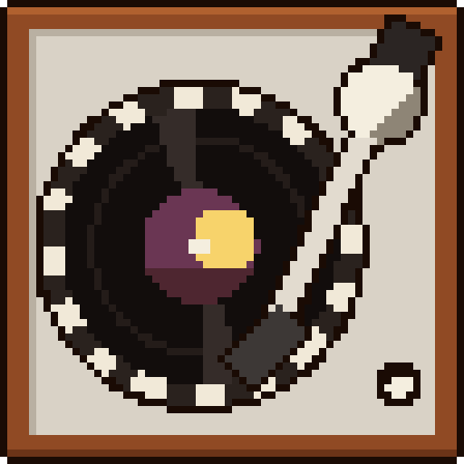

<h1 align="center">Ritmelli</h1>

Pixel-art turntables for Windows that play music into your game or voice-chat mic, with live voice effects.

- Search YouTube or paste a link, keep your records on the shelf and play them for everyone in the game or the call.
- Two decks, a mixer with automatic transitions, and quick sounds one click away.
- Voice effect pedals: megaphone, FM radio announcer, echo, bathroom, cathedral, robot, chipmunk, demon, blown speaker and more.

**Download:** [latest release](https://github.com/ritmelli/ritmelli-releases/releases/latest)

**Source code:** [ritmelli/ritmelli](https://github.com/ritmelli/ritmelli) (GPLv3)
